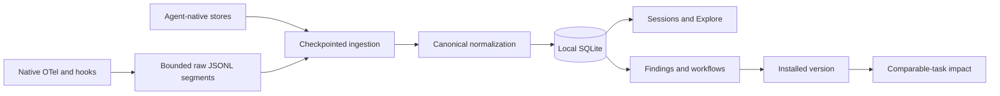
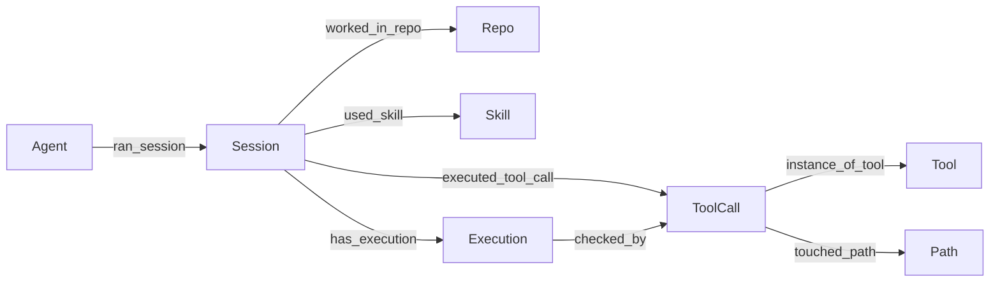
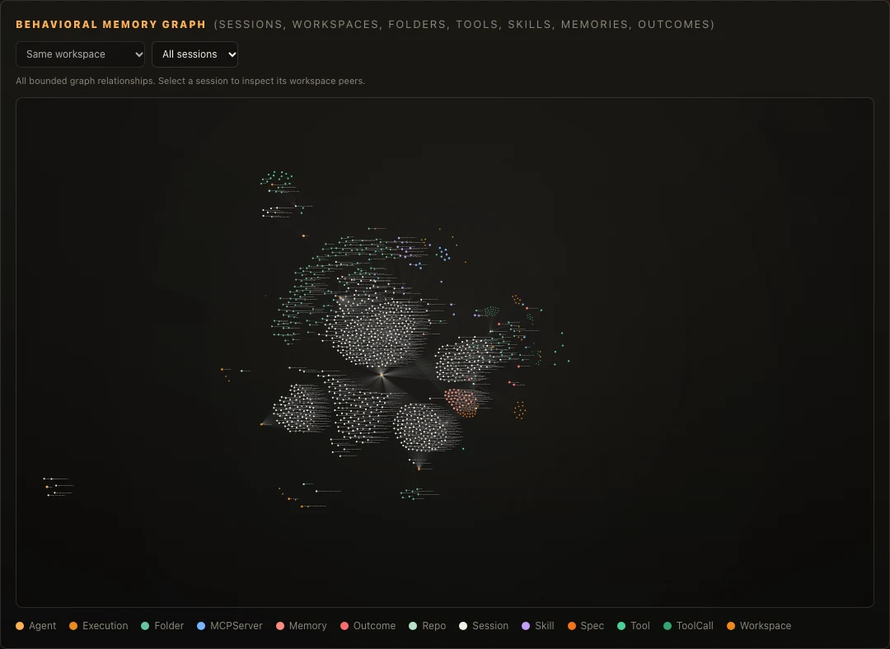
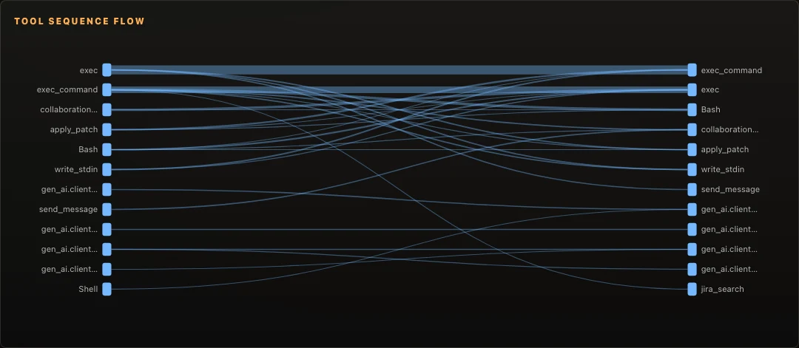
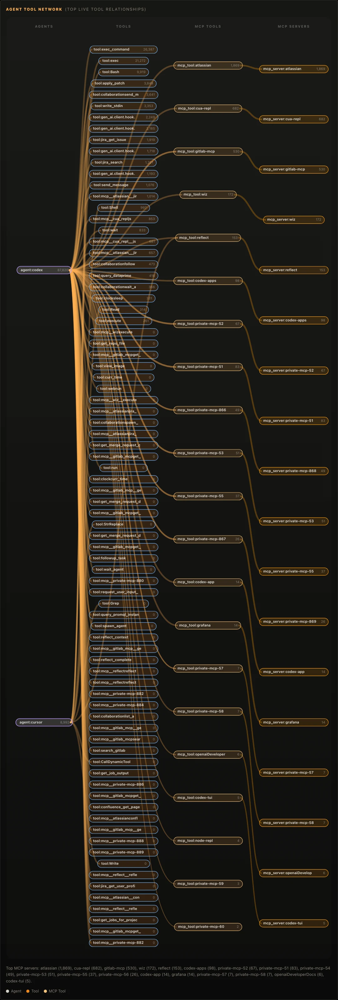
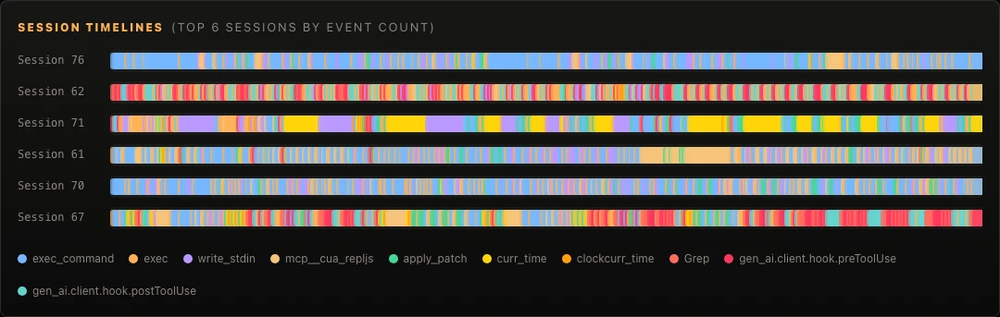
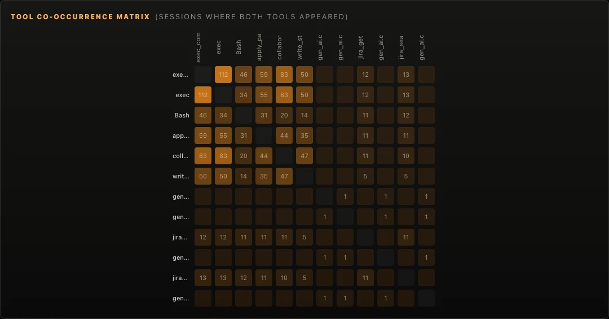
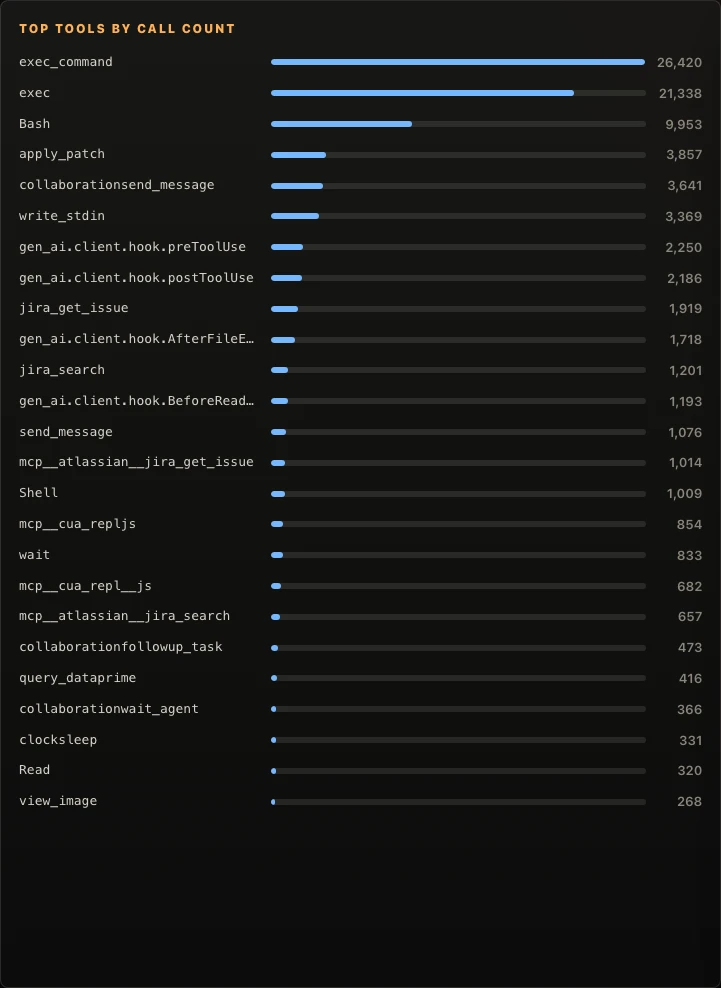
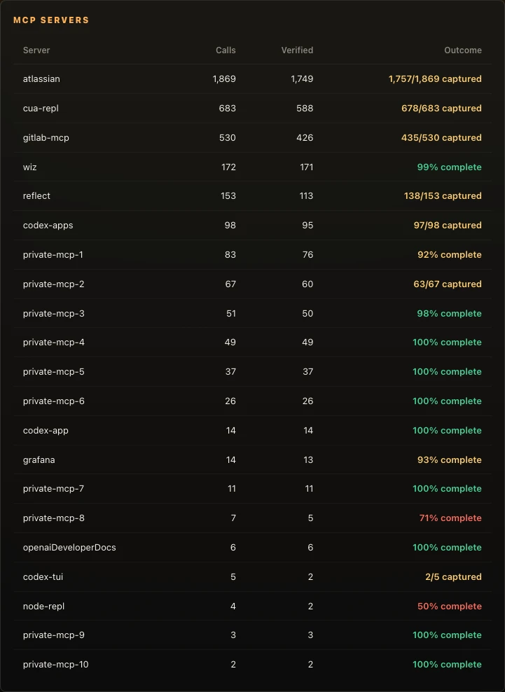
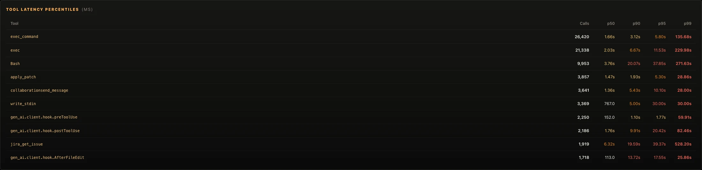

<p align="center">
  <a href="https://reflect.o11y.dev/">
    
  </a>
</p>

<h1 align="center">reflect</h1>

<p align="center">
  <strong>Keep what your agents figure out.</strong><br>
  Find repeated mistakes, review reusable skills, and check whether they help.
</p>

<p align="center">
  <a href="https://pypi.org/project/o11y-reflect/"></a>
  <a href="https://pypi.org/project/o11y-reflect/"></a>
  <a href="https://github.com/o11y-dev/reflect/actions/workflows/test.yml"></a>
  <a href="LICENSE"></a>
</p>

<p align="center">
  <a href="https://reflect.o11y.dev/">Website</a> ·
  <a href="https://reflect.o11y.dev/report.html?report=reports/showcase.json">Explore a synthetic example — no installation</a> ·
  <a href="https://pypi.org/project/o11y-reflect/">PyPI</a> ·
  <a href="CONTRIBUTING.md">Contributing</a> ·
  <a href="CHANGELOG.md">Changelog</a>
</p>

Reflect shows where coding agents get stuck, helps you turn useful routines
into skills you review, and checks whether those skills help on future tasks.
Inspect the supporting evidence, including when there is not enough to judge
the result.

No hosted backend and no Reflect account are required. Telemetry, task
evidence, workflow reviews, and SQLite state remain on your machine.

## Quick Start

Reflect requires Python 3.12+. The supported operating systems are macOS and
Linux. Review the public [install script](https://reflect.o11y.dev/install.sh),
then install and configure Reflect with one command:

```bash
curl -fsSL https://reflect.o11y.dev/install.sh | sh
reflect doctor
reflect
```

For a fresh installation, the script uses an available package manager in this
order: pipx, uv, then Python's pip in an isolated environment. It never uses
`sudo` or changes the system Python. It runs `reflect setup` after installation;
in a terminal you choose the integrations and text-capture mode, while
non-interactive use defaults to all detected agents with metadata-only capture.

Re-run the same command to update Reflect. The script detects whether the active
installation belongs to pipx, uv, or pip, upgrades it with that owner, and
preserves the existing setup.

Prefer manual installation?

```bash
pipx install o11y-reflect
# or: uv tool install o11y-reflect
reflect setup
```

`reflect setup` starts the local OTLP gateway, registers `reflect-mcp`, and
installs the packaged Reflect skills. On macOS it can register the gateway and
report server for login startup; pass `--no-autostart` to opt out.

`reflect doctor` is the source of truth for capture readiness. It distinguishes
configuration from an observed event, an ingested session, and reconciled
logical calls.

### Ask through your agent

Use Reflect in the agent where the work is already happening:

```text
Use Reflect to explain why this session was expensive and what should improve.

Use Reflect to find a repeated engineering procedure worth making reusable.

Use Reflect to prepare an internal AI budget increase request from measured work.

Use Reflect to show whether an installed workflow improved comparable tasks.
```

The packaged skill starts a non-trivial repository task with
`reflect_context`, keeps selected guidance tied to a task run, and closes it
with `reflect_complete` after validation. It can inspect evidence and prepare a
review, but it cannot install or change a workflow without explicit human
approval.

### Explore visually in the UI

```bash
reflect
```

The browser opens at `http://127.0.0.1:8765`. It reads the same local SQLite
evidence as the CLI and MCP server. The normal refresh-enabled server prepares
new telemetry immediately and every five minutes; `reflect server start` is
snapshot-only unless `--refresh` is supplied.

No data yet? Open the bundled cross-agent demonstration:

```bash
reflect --demo
```

The demo contains Claude, Codex, Copilot, Cursor, and historical Gemini
sessions. Demo coverage is not a claim that every provider surface is currently
live-supported.

## From Personal Reflection to Organizational Improvement

The product loop is:

> task contract -> execution evidence -> human review -> installed workflow ->
> comparable future tasks -> measured impact

The browser has six surfaces:

| Surface | What it answers |
|---|---|
| **Sessions** | What happened, what did it cost, and which source evidence is available? |
| **Inbox** | Which findings and repeated behaviors need investigation before becoming interventions? |
| **Workflows** | Which bounded intervention contracts need review, installation, or rollback? |
| **Skills** | Which versioned procedures exist, where are they installed, and have agents used them? |
| **Impact** | Did comparable task outcomes move after installation, and is attribution supported? |
| **Explore** | What do usage, tools, MCP, graph, context, and task contracts show? |

A finding or loop is evidence, not an installed improvement. Approval and
installation are separate. Impact begins only after a workflow is installed,
and missing baseline evidence is shown as unavailable rather than zero.

### Skills Registry

Skills are durable, versioned procedures—not another label for findings or
workflow drafts. The Skills surface shows registry state, installation targets,
source evidence, observed exposure, and measured outcomes without implying that
a registered skill is installed or effective. Use `reflect skills` or
`reflect_skills` for the same local registry through the CLI or MCP.

## What Reflect Can Prove

Skills includes a **Where used** view: follow a captured skill read or agent
report into its session, attributed execution and verification evidence. The
graph and evidence table share the same filters and bounded pagination. Unknown
versions and ambiguous ownership stay visible instead of being guessed.

Workflows and Impact retain recorded evidence while background analysis runs.
Verification is scoped to the recorded execution and check time; a later
relevant edit can invalidate it. A completion report remains a report, and a
skill occurrence alone does not establish effectiveness.

Workflow discovery and skill drafting share a bounded procedure evidence model.
It matches ordered operations and artifact areas while keeping exact test
selectors and verification scopes distinct. Automatic candidates need current
passing-check evidence across three independent sessions. Failed checks,
invalidated verification and unknown task outcomes remain in the evidence.
Both detail views explain the match and link its examples. Extracted drafts cite
their own sources; weak evidence can produce no candidate.

Same-named skills from independent installation paths have separate identities.
Generated skills retain their workflow identity, and captured versions are never
replaced with today's version when explaining historical use. Unresolved legacy
provenance stays separate until evidence establishes an owner.

Reflect derives these views from canonical local evidence:

- session conversations, outcomes, duration, agents, and source provenance
- exact or explicitly estimated tokens and cost, with model and cache breakdowns
- one logical count per tool or MCP invocation
- failures, retries, recovery, verification, edits, and delegation
- bounded task executions and comparable task archetypes
- workflow contract adherence before and after installation
- measured outcome shifts and the evidence quality required for attribution

Reflect does not rank developers or agents. It does not combine unrelated task
types, treat an entire long-lived session as one task, or convert correlation
into causality.

## Trust and Privacy Contract

- Local traces, logs, native session data, and `reflect.db` stay under local
  state paths and supported agent-owned stores.
- Prompt and response text capture is opt-in. Setup offers metadata-only,
  masked-text, and full-text modes.
- Normalized evidence keeps source provenance and marks token/cost estimates.
- External or repository writes require exact preview and explicit approval;
  apply and rollback are separate recorded actions.
- Workflow impact exposes compared task IDs, cohort size, missing telemetry,
  evidence cutoff, and the reason a claim is withheld.
- Retention can remove telemetry without silently installing, applying, or
  changing reviewed workflows.

For non-interactive setup, choose capture explicitly:

```bash
reflect setup --text-capture-mode metadata
```

Project-local agent wiring is opt-in:

```bash
reflect setup --agent "Claude Code" --local-agent "Claude Code"
```

## Agent Capability Truth

Support is declared per surface. A working MCP connection does not prove native
tokens, cost, hooks, or transcripts.

| Agent | Status | Current evidence path |
|---|---|---|
| Claude Code | Supported | Native OTel + hooks + native sessions |
| Cursor | Supported | Session/log adapters + optional hooks |
| Antigravity | Partial | Reflect MCP task runs; native tool telemetry unverified |
| GitHub Copilot | Supported | Native OTel + hooks + native sessions |
| OpenAI Codex CLI | Supported | Native OTel + native sessions |
| OpenCode | Supported | Native SQLite sessions + hooks |
| Windsurf | Supported | Hooks + configuration snapshots |
| Gemini CLI | Historical | Historical native OTel + session adapter |

Planned agents may be inventoried for configuration or skill paths, but Reflect
does not label them as capturing.

Antigravity's current CLI alias is `agy`; Windsurf MCP setup is editor-config only.

The registry in `src/reflect/agent_capabilities.py` feeds setup, doctor, aliases,
skill distribution, MCP configuration, and local-agent tests.

## How Capture Works



The gateway appends to `otel-traces.active.jsonl` and
`otel-logs.active.jsonl`, rotating immutable closed segments at a bounded size.
Refresh checkpoints each source, normalizes new records, and deletes only
closed segments whose events normalized successfully. Use
`--keep-processed-raw` when replay files must be retained.

The combined trace-and-log replay buffer has a 4 GiB hard admission limit by
default. At the limit the gateway preserves every existing byte and rejects new
HTTP telemetry with `507` or gRPC telemetry with `RESOURCE_EXHAUSTED`; it never
deletes unprocessed evidence to make room. The dashboard, `reflect doctor`, and
`reflect gateway status` warn at 80% and show when capture is paused. A
successful refresh removes eligible processed closed segments and capture then
resumes automatically.

Operators can override the positive byte and cadence values before starting the
managed services:

```bash
REFLECT_OTLP_MAX_BYTES=4294967296           # combined raw traces + logs
REFLECT_OTLP_SEGMENT_BYTES=268435456        # one active segment
REFLECT_REFRESH_INTERVAL_SECONDS=300        # refresh-enabled report server
REFLECT_ANALYSIS_WINDOW_DAYS=7              # automatic analysis; history is retained
REFLECT_SQLITE_BUSY_TIMEOUT_MS=30000         # writer wait; 0 means no wait
```

Refresh and maintenance commands coordinate across processes. Imports commit in
batches, and a failed refresh remains incomplete until `reflect refresh` repairs
it. The dashboard can retain its last completed cached view; requests needing an
incomplete snapshot return a retryable response. `reflect_improvements`,
`reflect_impact`, and `reflect impact` can inspect retained evidence during refresh
with explicit pending coverage. MCP context caps each SQLite
writer wait at one second, then returns available memory/guidance with an explicit
tracking limitation. Guidance queries share one read transaction, and no-change
usage refreshes preserve completed reports. Increasing the SQLite timeout permits longer waits; it does
not increase the number of simultaneous writers.

Automatic refresh analyses changed recent activity in a seven-day window.
Canonical usage still accounts for all incoming telemetry, including delayed old
events. Late corrections to historical work remain eligible for analysis. Core
usage publishes before graph and workflow analysis; those panels show their
separate readiness. Pending work is durable, so a restart resumes unfinished
phases. Historical findings are retained when they leave the automatic window.
Use the dashboard's **All time** range for retained usage, and explicitly refresh
historical analysis with `reflect refresh --session SESSION_ID` or
`reflect refresh --all-history`.

`tool_calls` stores one logical invocation. `mcp_calls` is a one-to-one metadata
extension for MCP server, tool, transport, and protocol identity, not a second
call ledger.

See the [contribution guide](CONTRIBUTING.md#architecture-and-ownership) for
module ownership, data flow, and architectural guardrails.

## Common Commands

```bash
reflect usage                         # current runtime usage
reflect usage --global --period week # all matching local usage for seven days
reflect refresh --json               # explicit ingest and snapshot refresh
reflect refresh --analysis-days 7    # bounded analysis, retaining all history
reflect refresh --session SESSION_ID # explicitly refresh historical analysis
reflect improve                      # scoped findings
reflect loops                        # observed stalled or productive loops
reflect workflows list               # reviewable and historical workflow state
reflect skills                       # durable skill registry
reflect memory sync .                # sync scoped instruction memory
reflect doctor                       # capture and installation diagnostics
```

Read commands inspect an existing query-only snapshot. Commands that refresh,
install, roll back, prune, or vacuum are explicit mutations.

### Direct OTLP input

An explicit trace file remains supported for imports and tests:

```bash
reflect --otlp-traces path/to/otel-traces.json
```

If a sibling `otel-logs.json` exists, Reflect reads it as the corresponding log
source. The managed gateway uses the bounded `.active.jsonl` segment names.

## Workflow and Impact Lifecycle

Reflect keeps these states separate:

1. Evidence produces a finding or loop.
2. A workflow candidate defines a typed procedure and validation window.
3. The developer's human review approves an exact immutable revision.
4. Explicit apply installs that version at one target.
5. The next comparable task executions record exposure and adherence.
6. Impact compares the frozen baseline with the bounded post-install cohort.
7. The developer keeps, revises, or rolls back the installation.

An approved-but-uninstalled workflow is never selected as executable guidance.
Workflow identity comes from contract semantics; a title or wording edit alone
does not invent a new procedure.

### UI: turn an Inbox finding into a workflow

1. Open **Inbox** and inspect **View Task Evidence** on a finding.
2. Select **Create workflow from finding**. If a workflow is already linked,
   use **Open Linked Workflow** instead.
3. Edit the draft instructions and verification steps, and select the target
   project folder. Reflect retains the server-resolved finding evidence,
   project scope, target metric and baseline link. These describe the observed
   problem; they do not prove the proposed instructions will help.
4. Select **Save draft and preview**, inspect the exact project file changes,
   then explicitly select **Enable workflow**. Saving a draft does not install it.
5. Run comparable tasks in that project. Use **Skills → Where used** to inspect
   captured usage, and **Impact** to inspect the baseline, subsequent executions,
   comparison and exclusion reasons.

For example, a finding about repeated tool failures can become a procedure to
inspect the failure, change the relevant input or state, and verify recovery
before retrying. Treat those instructions as a proposed intervention until
captured executions support a comparison.

**Workflows → Create workflow** also accepts standalone instructions, but does
not automatically attach an Inbox finding or its baseline. Use the Inbox action
when you want to preserve that connection. Conflicting saves keep your edits;
open the existing linked draft to review the difference.

### CLI: inspect, enable and monitor the same workflow

Replace the uppercase IDs with IDs returned by Reflect. Run preview and apply
from the target project directory; the CLI uses the current working directory.

```bash
cd /path/to/project
reflect improve --path .                    # inspect findings for this project
reflect improve OBSERVATION_ID --json       # inspect a selected finding
reflect workflows list                     # includes drafts created in the UI
reflect workflows show WORKFLOW_ID          # instructions and exact file diff
reflect workflows apply WORKFLOW_ID         # explicitly enable after review
reflect skills                             # find the registered skill ID
reflect skills show SKILL_ID --json         # versions, installs and captured usage
reflect impact --workflow-id WORKFLOW_ID --json
reflect workflows rollback WORKFLOW_ID      # optional: undo the installation
```

The CLI currently has **no create-from-finding or dismiss/restore command**.
Use the Inbox for those actions, then continue with the shared workflow ID in
the CLI. `reflect workflows add SKILL.md` imports an existing skill as a pending
draft; it does not attach a finding's metric or baseline. Its `--from-workflow ID`
option links bounded source-session evidence from an existing workflow, not
the full finding-to-impact relationship.

### Generate skills and monitor their use

Agent-assisted discovery proposes reusable instructions from captured work;
it does not install them. Choose a supported, locally available agent CLI:

```bash
reflect skills discover --agent codex --period week
reflect skills show SKILL_ID --json
# After explicitly reviewing the draft, from the target project:
reflect skills apply SKILL_ID
```

For a particular detected loop, use `reflect loops show LOOP_ID --json`, then
`reflect loops build LOOP_ID --agent codex` to generate a pending draft from its
bounded evidence. Discovery and loop building are separate from creating a
draft for a selected Inbox finding.

You can also author a `SKILL.md` and stage it with
`reflect workflows add ./SKILL.md`. For example:

```markdown
---
name: verify-before-retry
description: Use after a failed tool call before retrying the same operation.
---
1. Inspect the error and confirm the intended operation and target.
2. Identify and change the failed precondition or input before retrying.
3. Retry once and verify the result; stop and report the blocker if it persists.
```

This example is a proposed procedure, not evidence of effectiveness. Review the
returned workflow ID with `reflect workflows show ID` before applying it.

After subsequent work, inspect **Skills → Where used** or
`reflect skills show SKILL_ID --json`. Use `reflect skills sync` explicitly to
reconcile files and registry state; plain `reflect skills` is read-only. Use
`reflect refresh` explicitly when fresh telemetry analysis is needed. Discovery
can request that preparation with `--refresh`; it otherwise uses existing
prepared evidence and may require waiting for an active refresh.

With the packaged Reflect skill and MCP configured, an example request is:

> Inspect this project's repeated failures, show the supporting executions,
> and propose a reusable skill for review. After I enable it, show where it was
> used and whether comparable task outcomes changed. Explain any missing baseline.

The skill uses `reflect_context` to retrieve eligible guidance at task start,
`reflect_record_milestone` for contracted checkpoints, and `reflect_complete`
after validation. `reflect_skills` and `reflect_impact` inspect the registry and
comparison evidence. These tool calls do not automatically authorize installation.

**Installation, observed usage and measured improvement are different states.**
A skill read or reported use does not prove adherence or causality. Impact needs
a supported metric, an identifiable project/task scope, a usable pre-install
baseline and enough comparable post-install executions. It can remain collecting
evidence or explicitly unmeasurable; missing evidence is never a zero or a saving.

### Explore the evidence ontology graph

Open **Explore → Graph** to inspect captured relationships, or use the skill's
**Where used** view for usage linked to sessions and executions. The ontology
defines allowed entity and relationship types; it validates graph structure,
not whether a relationship proves success.

This subset uses the actual relationship names:



Other supported entities include workspaces, folders, MCP servers, subagents,
specifications, memories and outcomes. See the canonical
[ontology vocabulary](src/reflect/store/graph_ontology.py) for allowed endpoints.
Graph views are filtered and bounded, so a missing displayed edge does not prove
that an event never occurred. Follow source evidence and verification timestamps;
a later relevant edit can invalidate an earlier check.

Findings, workflow approvals and impact comparisons are linked application
records, not additional node types in this ontology. Use the finding evidence
ledger and Impact comparison for that lifecycle. The graph helps trace what
happened; it does not replace the before/after measurement. There is currently
no dedicated `reflect graph` CLI command; use the browser graph and the CLI/MCP
evidence inspection commands above.

#### Graph widgets in the local dashboard

Captured from the local dashboard's **Last 7 days → Explore → Graph** view on
November 14, 2026. Session IDs, behavioral graph labels and environment-specific
MCP names are anonymized for documentation. Shapes and counts come from the
rendered local report; they show activity, not measured workflow improvement.
Each image includes the complete widget, including content below the viewport.
[View the full-page capture](docs/images/explore-graph/full-page.webp).

**Behavioral Memory Graph** connects the bounded entities and relationships
described above. Use the workspace/session controls to narrow a dense graph.



<details>
<summary>Tool Sequence Flow</summary>

Transitions between captured tools show recurring sequences to investigate.
Frequency alone does not establish that a sequence is useful or wasteful.



</details>

<details>
<summary>Agent Tool Network — complete tall widget</summary>

Follow the displayed relationships from agents through tools, MCP tools and MCP
servers. This capture includes the entire network rather than only its first screen.



</details>

<details>
<summary>Session Timelines</summary>

Compare the event sequence in the six displayed high-event sessions. These are
bounded session views; use session drill-downs for the underlying evidence.



</details>

<details>
<summary>Tool Co-occurrence Matrix</summary>

Each populated cell counts sessions in which both tools appeared. Co-occurrence
does not imply ordering, a dependency or a successful outcome.



</details>

<a id="tools-and-mcp-screenshots"></a>

### Tools and MCP screenshots

Open **Usage & explore → Tools** for tool counts, MCP server evidence and latency.
These screenshots use the same local seven-day selection as the graph gallery;
environment-specific MCP server names are anonymized. Counts reflect the
displayed captured evidence and are not a measure of workflow effectiveness.

#### Top Tools by Call Count

See which captured tools dominate the selected session population. High call
counts alone do not establish useful work or waste.



#### MCP Servers — calls and captured outcome coverage

Inspect each server's call counts, verified records and outcome coverage.
Missing outcomes remain a coverage gap, not an assumed success or failure.



#### Tool Latency Percentiles

Compare p50, p90, p95 and p99 durations alongside call counts. Long tool duration
can include waiting; it does not directly measure active human work or savings.



## Reflect MCP

`reflect-mcp` is a local stdio MCP server. Its main tools are:

- `reflect_context` — start task-specific guidance
- `reflect_record_milestone` — record idempotent workflow checkpoints
- `reflect_complete` — close the task after validation
- `reflect_improvements`, `reflect_patterns`, `reflect_skills`, and
  `reflect_impact` — bounded read-only evidence
- `reflect_guidance_efficiency` — descriptive cost and model-request comparison for
  verified task executions in one repository, archetype, and exact model.
  Guidance delivery and reported selected skill outcomes are separate. An
  outcome report does not prove the skill was followed. Guided tasks remain
  in the cohort even without a selected skill outcome. Tasks with
  missing model identity or task-level model usage are excluded; this
  comparison does not prove causation. The response includes cache token mix,
  observed cache-read share, verified success rate, and cost per verified
  success when every model call has pricing. Impact remains the surface for
  installed workflow adherence and before/after results.
- `reflect_explain` and `reflect_usage` — provenance and exact usage
- `reflect_review_change` — return an exact diff, target, risks, and rollback
- `reflect_apply_change` — consume only the explicitly approved exact review

Setup writes the appropriate client configuration for Claude, Cursor,
Antigravity, Copilot, Codex, OpenCode, and Windsurf. Windsurf has no supported
headless test surface. Historical Gemini telemetry parsing is independent of
current Antigravity MCP configuration.

To verify one task lifecycle after capture:

```bash
reflect usage --session <session-id> --refresh --json
```

A task that called `reflect_context` and `reflect_complete` should show two
successful logical MCP calls once its runtime telemetry has been ingested.

## Shell Completion

Setup leaves shell files unchanged by default. Review the exact target paths and
managed block before an explicit Bash, Zsh, or Fish installation:

```bash
reflect completion --install
reflect setup --shell-completion
reflect completion --shell zsh
```

## Development

Source development uses Poetry:

```bash
poetry install --extras test
poetry run reflect --demo
poetry run reflect doctor
poetry run pytest tests/test_dashboard_sql_api.py -q
poetry run pytest -q
```

The browser is authored in `src/reflect/frontend/`. Regenerate both shipped
single-file artifacts after client changes:

```bash
poetry run python scripts/build_dashboard.py
```

Before a release:

```bash
poetry run ruff check .
poetry run pytest -q --no-cov
poetry run python scripts/release_workflow.py release-notes 0.9.7
```

See [CONTRIBUTING.md](CONTRIBUTING.md) for architecture, development, and review
conventions, and [the analysis schema](docs/ai-observability-schema.md) for
canonical telemetry fields.

## License

[Apache-2.0](LICENSE)
